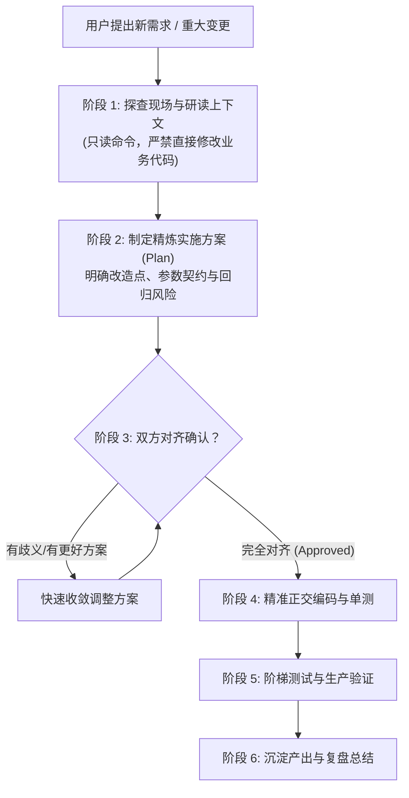

# 边缘原生全栈工程方法论与协作指南 (Edge Engineering Playbook)

本 Skill 是我们在构建 **`myauth`（统一身份中心）** 与 **`mylog`（知识库应用）** 过程中实战沉淀的**完整工程操盘手册**。
它覆盖了从**架构技术取舍**、**意图先行协作哲学**、**本地与线上全套指令集**，到**三层阶梯测试与排障验证**的全生命周期标准。

---

## 目录
1. [技术选型与架构取舍哲学 (Architecture Decisions)](#一技术选型与架构取舍哲学)
2. [“意图对齐先行”协作铁律 (Alignment-First Workflow)](#二意图对齐先行协作铁律)
3. [本地构建、测试与部署命令全集 (Command Playbook)](#三本地构建测试与部署命令全集)
4. [三层阶梯测试与线上真机探针体系 (Testing Strategy)](#四三层阶梯测试与线上真机探针体系)
5. [常见工程陷阱与秒级排障规范 (Best Practices & Traps)](#五常见工程陷阱与秒级排障规范)

---

## 一、 技术选型与架构取舍哲学

在边缘计算（Cloudflare Workers Isolates）与个人全栈工程中，**“轻量实用主义”永远优于“教条式的过度设计”**。

### 1.1 拒绝臃肿过度设计，回归经典三层服务架构
- ❌ **坚决摒弃**：拥有 20+ 抽象层、过度拆分领域事件、充斥着大量虚无接口（Port）和纯胶水代码（UseCase）的沉重六边形/DDD 架构。
- ✅ **全面收敛为经典三层架构**：
  ```text
  [表现层: Web Routes & Views] ➔ [业务服务层: Domain Services] ➔ [基础设施与存储: D1 / Vectorize / AI]
  ```
  - **Route 控制器**：仅负责解析 HTTP/HTMX 请求、读取/校验入参、调用对应 Service 并决定返回全页还是局部 HTML 片段；
  - **Service 服务层**：系统核心大脑，封装业务闭环（如标签 4 步收敛、SSO 用户同步、CTE 权限推导）；
  - **Database & Infra 存储层**：直接利用 Cloudflare 原生 Bindings（D1 预编译 SQL、Vectorize 向量检索、Workers AI 文本理解），消灭多余的 ORM 负担。

### 1.2 拒绝繁重单页框架，全面采用超媒体驱动架构 (HDA)
- ❌ **坚决摒弃**：Vue/React 庞大的打包构建链（Webpack/Vite 大 bundle）、复杂的状态管理（Pinia/Redux）、数据水合（Hydration）白屏延迟与首屏膨胀。
- ✅ **选择 HDA (HTML-over-the-wire) 极速栈**：
  - **渲染引擎**：Hono JSX (Edge SSR) —— 边缘极速直出 HTML，零打包构建负担；
  - **前端交互**：HTMX 2.0（声明式 `hx-get`、`hx-post`、`hx-target`、`hx-swap`）—— 0KB 业务 JS；
  - **样式系统**：原生 Vanilla CSS（CSS 变量驱动明暗主题，Zero FOUC 闪烁）。

### 1.3 拒绝昂贵外部云账单，实现 100% 边缘原生全自洽
- 不依赖任何外部第三方云存储账单（无需 AWS S3、不需要绑定信用卡买 R2）；
- 充分利用 Cloudflare 边缘生态免费配额组合拳：
  - **主数据库**：Cloudflare D1（SQLite 分布式边缘库）；
  - **大文本/文章存储**：直接利用 D1 的 `file_contents` 分片表替代对象存储；
  - **语义检索**：Cloudflare Vectorize（768 维 Cosine 余弦聚类）；
  - **边缘智能**：Cloudflare Workers AI（Llama 3.2 3B 摘要理解 + BAAI BGE 多语言嵌入向量）。

---

## 二、 “意图对齐先行”协作铁律

在 AI 辅助或双人结对编程中，**“想清楚再动手”永远比“盲目写大把代码”快 10 倍**。



### 协作执行 4 项硬指标：
1. **方案先行 (Plan First)**：
   涉及跨模块改造、SSO 对接、数据库表更迭时，必须先列出简明的**改动文件清单**与**影响面评估**，得到确认后再落子；
2. **最小侵入原则 (Minimal Invasion)**：
   新功能的引入必须像“微创手术”一样，尽量以外挂中间件、扩展方法的形式落地，**严禁为了接入新功能大面积推翻重写既有稳定逻辑**；
3. **防御性数据合并 (Defensive Merging)**：
   跨系统用户同步（如 SSO）必须具备容错机制（如优先按 `username` 检索复用存量账号），绝不能简单粗暴直接 `INSERT` 导致线上唯一键冲突；
4. **验证闭环 (Verification Loop)**：
   改动完成之后，必须按“类型检查 ➔ 单元测试 ➔ 线上探针”走完闭环，给出确凿证据，杜绝“代码写了但没测过”。

---

## 三、 本地构建、测试与部署命令全集

### 3.1 本地开发与环境初始化
```bash
# 1. 安装项目依赖
npm install

# 2. 启动本地离线开发服务器
npm run dev

# 3. 启动本地连通远程云端资源的开发服务 (当涉及 Workers AI 或 Vectorize 真机调试时)
npm run dev:remote
```

### 3.2 数据库迁移 (D1 Migrations)
```bash
# 本地 SQLite 开发数据库迁移
npm run d1:migrate:local
# 等价原生命令: npx wrangler d1 migrations apply <DB_BINDING> --local

# 线上生产环境 D1 数据库执行迁移
npm run d1:migrate:remote
# 等价原生命令: npx wrangler d1 migrations apply <DB_BINDING> --remote
```

### 3.3 构建与静态类型检查
```bash
# 执行无打包开销的纯静态 TypeScript 类型检查
npm run build
# 底层命令: tsc --noEmit
```

### 3.4 自动化单元测试 (Vitest)
```bash
# 运行单次全量测试 (用于 CI/CD 与提交前自检)
npm test
# 底层命令: vitest run

# 启动监听模式 (代码改动自动秒级热重跑)
npm run test:watch
# 底层命令: vitest
```

### 3.5 边缘部署上线与线上观测
```bash
# 一键发布部署至 Cloudflare 全球边缘网格
npm run deploy
# 底层命令: wrangler deploy

# 线上生产环境毫秒级实时日志追踪 (排查线上异常首选)
npx wrangler tail

# 线上 D1 数据库现场只读快速核验 (SQL 诊断)
npx wrangler d1 execute <DB_BINDING> --remote --command "SELECT * FROM users LIMIT 5;"
```

---

## 四、 三层阶梯测试与线上真机探针体系

系统质量保障采取 **“三层金字塔”** 结构：

```text
       ▲
      / \     [第三层: 线上生产健康体检探针]  GET /api/health-infra (秒级验证 D1/AI/向量/SSO)
     /   \
    /     \   [第二层: 远程联调与热重载]    npm run dev:remote (验证真实边缘硬件与模型输出)
   /       \
  /_________\ [第一层: 毫秒级单元测试]      npm test (覆盖算法核心、SSO验签协议、递归CTE推导)
```

### 4.1 第一层：自动化单元测试 (Vitest)
- **定位**：运行速度 `<500ms`，无需启动网络服务；
- **覆盖核心**：
  1. 纯算法：标签词法清洗、同义词映射、四级漏斗过滤；
  2. RBAC：Snowflake 角色多层继承有向图展开、特权裁决矩阵；
  3. SSO：换票入参封装、SSO 授权跳转地址生成、未登录 HTMX `HX-Redirect` 拦截。

### 4.2 第二层：本地与远端真机联调 (`dev:remote`)
- **定位**：解决“本地 Miniflare 无法离线模拟神经网络和余弦向量索引”的痛点；
- **用法**：执行 `npm run dev:remote`，终端代码改动时实时上传轻量预览环境，直接调用云端真实绑定的 Workers AI 与 Vectorize。

### 4.3 第三层：无需停机的线上全栈自检探针 (`/api/health-infra`)
每个子系统必须统一内置该探针接口，作为秒级故障定位的第一现场：

```typescript
app.get('/api/health-infra', async (c) => {
  const report: Record<string, any> = { timestamp: new Date().toISOString() };

  // 1. 检查 D1 主库
  try {
    const d1Res = await c.env.DB.prepare('SELECT COUNT(*) as count FROM files').first();
    report.d1 = { status: 'healthy', count: d1Res?.count ?? 0 };
  } catch (err: any) {
    report.d1 = { status: 'error', message: err.message };
  }

  // 2. 检查 Workers AI 神经网络
  if (c.env.AI) {
    try {
      const ping = await c.env.AI.run('@cf/meta/llama-3.2-3b-instruct', {
        messages: [{ role: 'user', content: 'Ping' }],
        max_tokens: 5,
      });
      report.workersAi = { status: 'healthy', sample: ping?.response || ping };
    } catch (err: any) {
      report.workersAi = { status: 'error', message: err.message };
    }
  }

  // 3. 检查 Vectorize 向量索引
  if (c.env.TAG_VECTORS) {
    try {
      const desc = await c.env.TAG_VECTORS.describe();
      report.vectorize = { status: 'healthy', details: desc };
    } catch (err: any) {
      report.vectorize = { status: 'error', message: err.message };
    }
  }

  // 4. 检查上游统一认证中心连通性
  const hubUrl = c.env.AUTH_HUB_URL;
  if (hubUrl) {
    try {
      const t0 = Date.now();
      const authResp = await fetch(`${hubUrl}/api/verify`, { signal: AbortSignal.timeout(3000) });
      report.myauth = {
        status: authResp.status === 401 || authResp.ok ? 'healthy' : 'degraded',
        latencyMs: Date.now() - t0,
      };
    } catch (err: any) {
      report.myauth = { status: 'error', message: err.message };
    }
  }

  return c.json(report);
});
```

---

## 五、 常见工程陷阱与秒级排障规范

### 1. 存量用户跨系统同步时唯一键冲突 (`SQLITE_CONSTRAINT_UNIQUE`)
- **陷阱**：子系统的 `users` 表已有存量用户 `fanxiao`（ID: `usr_local`），SSO 中心下发的全局 ID 是 `usr_global`。如果子系统直接使用 `INSERT`，必定因 `username UNIQUE` 报错崩塌。
- **解法**：先通过 `SELECT id FROM users WHERE username = ?` 查找存量账号。若命中，则直接**复用本地旧 ID**，绝不二次插入；此时本地所有的文档所有权和历史记录完全保留，无缝升级。

### 2. HTMX 异步超媒体请求丢失重定向上下文
- **陷阱**：用户在未登录状态下点击某个需要登录的 HTMX 按钮，后端返回常规 HTTP 302，浏览器把它作为普通 Fetch 结果塞进局部容器，造成界面嵌套死循环。
- **解法**：守卫拦截时检查 `c.req.header('HX-Request')`，必须下发：
  ```typescript
  c.header('HX-Redirect', loginUrl);
  return c.text('', 401);
  ```

### 3. Workers AI 返回值格式随版本变动的兼容性陷阱
- **陷阱**：某些 Workers AI 运行时版本返回的是纯文本字符串，另一些环境会自动将其反序列化为 JSON JavaScript 对象。如果盲目调用 `.match()` 或 `.split()`，会偶发抛出 `TypeError: rawText.match is not a function`。
- **解法**：提取元数据时做类型自适应守卫：
  ```typescript
  const resp = aiResponse?.response ?? aiResponse;
  if (resp && typeof resp === 'object') {
    return { tags: resp.tags, summary: resp.summary };
  }
  // 否则执行正则截取 JSON 字符串
  ```
