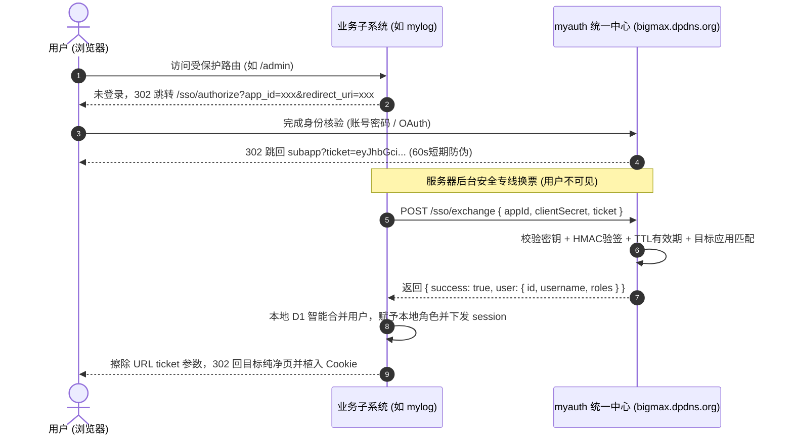

# 边缘原生 SSO 与 Snowflake RBAC 全景开发指南 (Edge SSO Suite)

本 Skill 沉淀自 `myauth`（统一身份中心）与 `mylog`（知识库子系统）的真实生产落地经验。
专为在 **Cloudflare Workers (V8 Isolates) + Hono + D1 + HTMX** 技术栈下，快速构建与接入无冷启动、零外部云账单、高安全性的统一认证与细粒度授权系统提供标准化规范与代码模板。

---

## 一、 系统架构与心智模型 (Mental Model)

### 1.1 核心分工原则：“身份下沉，权限自治”
- **统一认证中心 (`myauth`)**：
  - 扮演“国家护照局”角色；
  - **单点保管所有用户凭据**：PBKDF2 加盐散列、Google OAuth、GitHub 联合登录凭据；
  - **集中发放 Ticket 与 Access Token**；
  - **定义全局角色**（如 `rol_accountadmin`、`rol_admin`、`rol_user`）。
- **业务子系统 (`mylog` / 其他应用)**：
  - 扮演“特定场馆”角色；
  - **绝不存储用户密码**；
  - **维护本地业务对象特权**（如文档的 `READ`/`WRITE`/`DELETE`/`OWNERSHIP`）；
  - **利用本地 D1 缓存 Session**（读操作 `<1ms`，避免高频跨网往返）；
  - **基于 Snowflake 递归 CTE 单条 SQL 完成多层继承权限裁决**。

### 1.2 60秒 Ticket 换票时序模型


---

## 二、 3 分钟新子系统极速接入流水线

任何全新的 Cloudflare Workers + Hono 子应用（例如 `mychat`、`mytools`），只需以下 **3 步** 即可完成对接：

### 步骤 1：在 `myauth` 登记应用
在 `myauth` 的 D1 数据库执行（或通过管理员后台添加）：
```sql
INSERT INTO apps (id, name, domain, client_secret, created_at)
VALUES ('app_mychat', 'MyChat 实时通讯', 'https://chat.bigmax.dpdns.org', 'sec_生成的随机密钥', strftime('%s','now')*1000);
```

### 步骤 2：配置子系统 `wrangler.toml` 与 `types.ts`
在子系统的 `wrangler.toml` 注入环境变量：
```toml
routes = [
  { pattern = "chat.bigmax.dpdns.org", custom_domain = true }
]

[vars]
AUTH_HUB_URL = "https://bigmax.dpdns.org"
MYAUTH_APP_ID = "app_mychat"
MYAUTH_CLIENT_SECRET = "sec_生成的随机密钥"
```

在 `src/core/types.ts` 声明 Bindings：
```typescript
export interface Bindings {
  DB: D1Database;
  AUTH_HUB_URL?: string;
  MYAUTH_APP_ID?: string;
  MYAUTH_CLIENT_SECRET?: string;
}
```

### 步骤 3：引入单文件守卫 SDK (`edge-auth-guard.ts`)
直接将以下模块拷贝至子系统 `src/web/middleware/edge-auth-guard.ts`：

```typescript
import { Context, Next } from 'hono';
import { getCookie, setCookie } from 'hono/cookie';

export interface SsoUser {
  id: string;
  username: string;
  email?: string;
  avatarUrl?: string;
  roles: string[];
}

export async function exchangeSsoTicket(
  authHubUrl: string,
  appId: string,
  clientSecret: string,
  ticket: string
): Promise<{ success: boolean; user?: SsoUser; error?: string }> {
  try {
    const resp = await fetch(`${authHubUrl}/sso/exchange`, {
      method: 'POST',
      headers: { 'Content-Type': 'application/json' },
      body: JSON.stringify({ appId, clientSecret, ticket }),
    });
    return (await resp.json()) as any;
  } catch (err: any) {
    return { success: false, error: err.message };
  }
}

export function getSsoAuthorizeUrl(authHubUrl: string, appId: string, currentUrl: string): string {
  return `${authHubUrl}/sso/authorize?app_id=${encodeURIComponent(appId)}&redirect_uri=${encodeURIComponent(currentUrl)}`;
}

export async function ssoSessionMiddleware(c: Context<any>, next: Next) {
  const authHubUrl = c.env.AUTH_HUB_URL || 'https://bigmax.dpdns.org';
  const appId = c.env.MYAUTH_APP_ID;
  const clientSecret = c.env.MYAUTH_CLIENT_SECRET;
  const { authService } = c.get('services');

  // 1. 处理 ?ticket= 回调换票
  const ticket = c.req.query('ticket');
  if (ticket && appId && clientSecret) {
    const res = await exchangeSsoTicket(authHubUrl, appId, clientSecret, ticket);
    if (res.success && res.user) {
      const { sessionToken, session } = await authService.syncSsoUser(res.user);
      const isProd = c.req.url.startsWith('https://');
      setCookie(c, 'app_session', sessionToken, {
        path: '/',
        httpOnly: true,
        secure: isProd,
        sameSite: 'Lax',
        maxAge: 60 * 60 * 24 * 7,
      });
      c.set('session', session);

      // 净化 URL 并重定向
      const cleanUrl = new URL(c.req.url);
      cleanUrl.searchParams.delete('ticket');
      cleanUrl.searchParams.delete('state');
      return c.redirect(cleanUrl.toString());
    }
  }

  // 2. 本地 Session 快速验证
  const token = getCookie(c, 'app_session');
  if (token) {
    const session = await authService.validateSession(token);
    if (session) c.set('session', session);
  }

  await next();
}

export async function requireAuthGuard(c: Context<any>, next: Next) {
  const session = c.get('session');
  if (!session) {
    const authHubUrl = c.env.AUTH_HUB_URL || 'https://bigmax.dpdns.org';
    const appId = c.env.MYAUTH_APP_ID;
    const redirectUrl = getSsoAuthorizeUrl(authHubUrl, appId, c.req.url);

    // 针对 HTMX 异步请求下发专用重定向头，避免被页面内部吞噬
    if (c.req.header('HX-Request')) {
      c.header('HX-Redirect', redirectUrl);
      return c.text('', 401);
    }
    return c.redirect(redirectUrl);
  }
  await next();
}
```

---

## 三、 本地用户同步标准实现 (`syncSsoUser`)

**最关键避坑点**：子系统本地数据库通常有 `username TEXT UNIQUE` 约束。当用户从 SSO 登录时，必须优先按 `username` 匹配已有历史账号，不可直接盲目 `INSERT`！

```typescript
async syncSsoUser(ssoUser: { id: string; username: string; roles: string[] }) {
  const userId = ssoUser.id;
  const username = ssoUser.username.trim().toLowerCase();
  const now = Date.now();

  let effectiveUserId = userId;

  // 1. 优先按 username 检索，复用存量账号以避免 UNIQUE constraint failed
  const existing = await this.db
    .prepare('SELECT id FROM users WHERE username = ?')
    .bind(username)
    .first<{ id: string }>();

  if (existing) {
    effectiveUserId = existing.id;
  } else {
    // 纯新用户，按 SSO ID 新建
    await this.db
      .prepare('INSERT INTO users (id, username, is_active, created_at) VALUES (?, ?, 1, ?)')
      .bind(userId, username, now)
      .run();
  }

  // 2. 映射超级管理员角色 (如果有)
  if (ssoUser.roles?.includes('rol_accountadmin')) {
    await this.db
      .prepare('INSERT OR IGNORE INTO user_roles (user_id, role_id, granted_by, granted_at) VALUES (?, ?, ?, ?)')
      .bind(effectiveUserId, 'rol_accountadmin', 'MYAUTH_SSO', now)
      .run();
  }

  // 3. 签发本地 Session
  const sessionToken = `ses_${crypto.randomUUID().replace(/-/g, '')}`;
  const expiresAt = now + 1000 * 60 * 60 * 24 * 7;
  await this.db
    .prepare('INSERT INTO sessions (id, user_id, expires_at) VALUES (?, ?, ?)')
    .bind(sessionToken, effectiveUserId, expiresAt)
    .run();

  return { sessionToken, session: { userId: effectiveUserId, username } };
}
```

---

## 四、 常见故障秒级定位与排障手册 (Troubleshooting)

### 故障 1：`D1_ERROR: UNIQUE constraint failed: users.username`
- **症状**：用户在 `myauth` 登录成功后，跳转回子系统页面抛出 500 错误。
- **定位**：本地 D1 数据库中已存在同名账号（历史本地创建，ID 与 `myauth` 不同），直接 `INSERT` 触发主键/唯一冲突。
- **解法**：在 `syncSsoUser` 中采用 `SELECT id FROM users WHERE username = ?` 优先查询存量用户；若命中则沿用本地历史 ID，不执行插入。

### 故障 2：HTMX 局部刷新时登录过期，页面卡死或报错
- **症状**：用户在未登录状态下点击某个 HTMX 按钮（如模态框、删除按钮），页面没有跳转到登录大厅，而是控制台报 401 或出现空的局部刷新。
- **定位**：HTMX 发出的 `fetch` 请求不会被浏览器默认的 HTTP 302 Location 接管跳转，而是把登录 HTML 塞进了局部的 `div` 里。
- **解法**：守卫检测 `c.req.header('HX-Request')`，若为 HTMX 请求，**必须设置响应头 `HX-Redirect: <登录URL>` 并返回状态码 401**，HTMX 收到后会自动命令整个浏览器窗口执行全页重定向。

### 故障 3：上线后 Cookie 无法保持（每次刷新都回到未登录）
- **症状**：登录成功跳回主页，但一旦刷新页面或者点击导航，又显示未登录。
- **定位**：
  1. Cookie 的 `Path` 未设置为 `/`，导致仅在回调路由有效；
  2. 在本地 `http://localhost` 开发时错误开启了 `secure: true`，浏览器拒绝落盘；
  3. `SameSite` 设置为 `Strict` 导致跨站 302 重定向时 Cookie 被浏览器剥离。
- **解法**：
  ```typescript
  setCookie(c, 'mylog_session', token, {
    path: '/',
    httpOnly: true,
    secure: c.req.url.startsWith('https://'),
    sameSite: 'Lax',
    maxAge: 60 * 60 * 24 * 7,
  });
  ```

### 故障 4：Ticket 换票报 `Ticket Expired or Invalid`
- **症状**：`/sso/exchange` 返回 400。
- **定位**：
  1. 票据有效期为 60 秒，若网络延迟或断点调试超过 60 秒则自动失效；
  2. 票据已被消费（One-time Ticket），重复使用会失效；
  3. 换票时传的 `appId` 与签发时的 `app_id` 大小写或拼写不一致。
- **解法**：确保子应用收到 `ticket` 后在同一次请求生命周期内立即换票，换票成功后立即重定向净化 URL，避免用户 F5 刷新重复提交废弃的 ticket。

---

## 五、 全栈健康诊断探针范式 (`/api/health-infra`)

为所有子系统统一内置标准化真机探针，几秒内完成基础设施与身份中心全链路自检：

```typescript
app.get('/api/health-infra', async (c) => {
  const report: Record<string, any> = { timestamp: new Date().toISOString() };

  // 1. D1 关系库
  try {
    const r = await c.env.DB.prepare('SELECT 1 as ok').first();
    report.d1 = { status: r?.ok ? 'healthy' : 'error' };
  } catch (err: any) {
    report.d1 = { status: 'error', message: err.message };
  }

  // 2. myauth 统一认证中心
  const authHubUrl = c.env.AUTH_HUB_URL || 'https://bigmax.dpdns.org';
  try {
    const t0 = Date.now();
    const resp = await fetch(`${authHubUrl}/api/verify`, { signal: AbortSignal.timeout(3000) });
    report.myauth = {
      status: resp.status === 401 || resp.ok ? 'healthy' : 'degraded',
      latencyMs: Date.now() - t0,
    };
  } catch (err: any) {
    report.myauth = { status: 'error', message: err.message };
  }

  return c.json(report);
});
```
